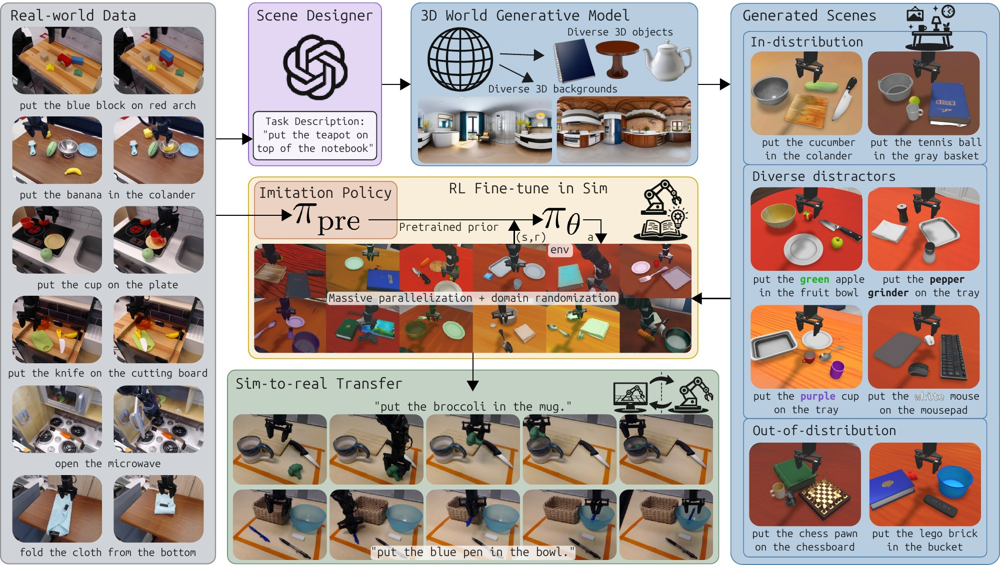
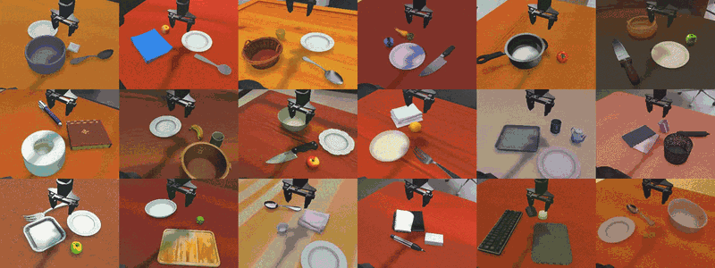

# [Scaling Sim-to-Real VLA Reinforcement Learning with Generative 3D Worlds](https://horizonrobotics.github.io/gail/scale-vla-rl/)



This repository runs PPO flow fine-tuning of an open-pi-zero policy trained on the Bridge dataset.
It loads a simulated WidowX 250S and several EmbodiedGen scenes in ManiSkill 3.


## Setup

Use Linux x86-64, Python 3.11, an NVIDIA GPU with CUDA and Vulkan support, the CUDA 12.8 toolkit, and uv. Install a C++ toolchain, CMake, Eigen, SWIG, and Python 3.11 development headers. The CUDA toolkit is used to build the Gaussian-splatting extensions.

From the repository root, set the CUDA environment and run the setup script. It initializes the pinned submodules, installs the locked dependencies, and builds kinematics solver `kincpp`.

```bash
export CUDA_HOME=/usr/local/cuda-12.8
export PATH="$CUDA_HOME/bin:$PATH"
export TORCH_EXTENSIONS_DIR="$PWD/.venv/torch-extensions"
./scripts/setup.sh
```

The top-level submodules are available over public HTTPS. ManiSkill and open-pi-zero are pinned to commits on their Scale VLA RL integration branches. Loading pre-generated scenes requires only the top-level EmbodiedGen checkout.

The first launch compiles the Gaussian-splatting CUDA extension. Clear `CPATH` if your shell adds headers from another Python version.

For a custom environment that uses FlashAttention, choose a wheel that matches its Python, PyTorch, and CUDA versions. [Prebuilt FlashAttention wheels](https://github.com/mjun0812/flash-attention-prebuild-wheels)

Install the Hugging Face CLI (`hf`) and accept Google's PaliGemma access terms. The download script fetches the Bridge imitation checkpoint that initializes PPO, the PaliGemma tokenizer, the WidowX robot assets, and the 100 EmbodiedGen training scenes. [Hugging Face CLI](https://huggingface.co/docs/huggingface_hub/en/guides/cli) · [PaliGemma access](https://huggingface.co/google/paligemma-3b-pt-224) · [Bridge checkpoint](https://huggingface.co/allenzren/open-pi-zero/blob/main/bridge_beta_step19296_2024-12-26_22-30_42.pt) · [EmbodiedGen scenes](https://huggingface.co/datasets/quantumope/scale-vla-rl-scenes)

After running `./scripts/setup.sh`, export these paths in the shell you will use to download assets and launch training.

- `TRANSFORMERS_CACHE` contains the Bridge weights at `bridge_beta.pt` and the tokenizer in `paligemma-3b-pt-224/`.
- `MS_ASSET_DIR` is the ManiSkill asset cache for the WidowX 250S.
- `EMBODIED_GEN_SCENES` contains the `task_####` directories directly, each with `layout.json` and its referenced assets.

```bash
hf auth login
export TRANSFORMERS_CACHE="$HOME/.cache/huggingface/hub"
export MS_ASSET_DIR="$HOME/.maniskill"
export EMBODIED_GEN_SCENES="$HOME/.cache/embodied_gen/scale_vla_rl_scenes"
./scripts/download_assets.sh
```

For offline training, set `HF_HUB_OFFLINE=1` after downloading the assets. The default config uses objects packaged with the scenes.

### Docker setup

Build the CUDA 12.8.2 image from the repository root.

```bash
docker build -f docker/Dockerfile -t scale_vla_rl:cuda12.8.2-torch2.7.1-py3.11-ubuntu22.04 .
```

The Docker guide shows how to mount the downloaded assets and run a training smoke test. [Docker guide](docker/README.md)

## Train

[](https://horizonrobotics.github.io/gail/scale-vla-rl/videos/rl-training-example.gif)

All experiments were trained on 8 GPUs. Set `CUDA_VISIBLE_DEVICES` to the eight device IDs allocated to your job. ALF launches one DDP worker per GPU. The `gsplat` import builds the CUDA extension before the workers start.
You may have to edit the batch sizes / gradient accumulation settings in `embodied_gen_ppo_flow_conf.py` depending on your GPU's VRAM.
Current settings are assuming at least 48GB per GPU.

```bash
export CUDA_VISIBLE_DEVICES=0,1,2,3,4,5,6,7
export CUBLAS_WORKSPACE_CONFIG=:4096:8
export PYTORCH_CUDA_ALLOC_CONF=expandable_segments:True

uv run python -c 'import gsplat.cuda._backend'
uv run python -m alf.bin.train \
  --distributed=multi-gpu \
  --num_gpus_per_ddp_worker=1 \
  --nccl_timeout=60 \
  --conf_param=make_ddp_performer.find_unused_parameters=True \
  --conf_param=TrainerConfig.confirm_checkpoint_upon_crash=False \
  --root_dir=runs/ppo-flow \
  --conf=src/confs/embodied_gen_ppo_flow.py \
  --conf_param=TrainerConfig.random_seed=1 \
  --conf_param=TrainerConfig.num_iterations=1000 \
  --conf_param=TrainerConfig.num_checkpoints=20
```

The single-GPU smoke run uses two environments and one scene. Run `./scripts/download_assets.sh 'task_0000/*'` to fetch only that scene.

```bash
uv run python -m alf.bin.train \
  --root_dir=runs/smoke \
  --conf=src/confs/embodied_gen_ppo_flow.py \
  --conf_param='DEBUG=True' \
  --conf_param='max_num_scenes=1' \
  --conf_param='TrainerConfig.num_iterations=1'
```

## Evaluate

Use `alf.bin.play` to play a checkpoint. The OpenCV window requires a graphical session. Lower `max_num_scenes` to load fewer scenes.

```bash
CUDA_VISIBLE_DEVICES=0 uv run python -m alf.bin.play \
  --conf=src/confs/embodied_gen_ppo_flow.py \
  --parallel_play=10 \
  --num_episodes=10 \
  # Set your ckpt path here. Can omit to just run the imitation checkpoint.
  --root_dir=runs/ppo-flow \
  --checkpoint_step=latest \
  # Can set from 1-100
  --conf_param=max_num_scenes=100 \
  # Loads Gaussian scenes in parallel (don't use for training)
  --conf_param=_cache_gs3d_models.parallel_load=True \
  # For live display
  --conf_param=opencv_display=True
```

## License

Released under the [Apache License 2.0](LICENSE).

## Citation

If our research has helped you, please consider citing the following paper!
```bibtex
@article{choi2026scalingsimtorealvlareinforcement,
      title={Scaling Sim-to-Real VLA Reinforcement Learning with Generative 3D Worlds},
      author={Andrew Choi and Xinjie Wang and Zhizhong Su and Wei Xu},
      journal={arXiv},
      year={2026},
}
```
